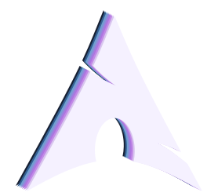

<p align="center"></p>

# SpectrumOS

**Work. Play. Defeat the Great Backlog.**

SpectrumOS is an **Arch Linux distribution** with a keyboard-driven **Hyprland** desktop, a **Quickshell** interface, wallpaper-driven colors, and widgets for practically everything. One system for your code, your campaigns, and the suspicious number of browser tabs you call research.

**Version 1.0.0 is here.** Your distro-hopping side quest may finally take a nap.

[Explore the desktop and screenshots](https://gibranlp.dev/en/spectrum/) · [Español](https://gibranlp.dev/spectrum/) · [Download and package repository](https://spectrum.gibranlp.dev/) · [Report a bug](https://github.com/gibranlp/SpectrumOS/issues)


## Meet your new command post

Inspired by [Caelestia Shell](https://github.com/caelestia-dots/shell), SpectrumShell is built with [Quickshell](https://quickshell.org/) on [Hyprland](https://hypr.land/). The bar, widgets, launcher, notifications, and desktop interactions share one visual language. Put the bar at the top or on the left, choose a detailed or Minimal profile, and keep your tools within reach.

Window controls stay consistent across **Dwindle, Master, Scrolling, and Monocle**. Multi-monitor controls, keyboard navigation, and integrated utilities handle the practical work behind the pretty screenshots. The menu labyrinth has lost another customer.

### Widgets that do the everyday work

Open a tool from the bar, the **More** menu, the application launcher, or its keyboard shortcut. Widgets share the desktop theme and work with both top and left bars.

| What you want to do | What SpectrumOS puts within reach |
| --- | --- |
| Plan the day | Dashboard calendar, Questline due tasks and steps, weather, time and region |
| Keep work organized | Campaigns, tasks, Markdown Scrolls, Chronicles, Treasury, focus sessions, and saved drafts |
| Control sound and connections | Wi-Fi and Ethernet, Bluetooth, output/input selection, volume, microphone controls, playback, and album artwork |
| Capture and find things | Annotated screenshots, screen and audio recording, file search across home folders and mounted drives |
| Keep a comfortable pace | Focus timer, optional eye and movement reminders, Do Not Disturb, notification history, and Keep Awake |
| Manage the desktop | Displays, brightness, wallpapers, typography, mouse settings, default applications, power and battery controls |
| Find apps and favorite places | App Store, AppImage Manager, Updates, categorized Favorites, and the application launcher |
| Run a development session | Local services, container controls, logs, calculator, HotKey sequences, and the shortcut catalog |
| Connect your computers | UKVM keyboard/mouse sharing and SpectrumDrop file transfers |

### Capture the moment, find the file

Press **Print** to open the screenshot widget. Capture an area, window, monitor, or the whole desktop, with a delay when needed. Add arrows, text, shapes, highlights, cropping, or blur in the annotation editor; turn annotations off for a direct capture. Screen and audio recording have their own widgets and visible recording indicators.

**Super + S** opens file search. Choose Home, a standard folder, a mounted drive, or a custom path, then search by filename. The widget remembers your search location, so an external project drive can stay one shortcut away. A calculator, password generator, emoji picker, and color picker with saved-color history handle the smaller interruptions.

### Music and volume, together

The audio widget brings playback controls, player selection, album artwork, audio devices, volume, and microphone controls into one place. When a song changes, its compact display shows the track and artist, plus a progress bar with elapsed and remaining time when the player provides timing.

Change the volume while music is playing and the volume section slides out beneath the song. Both stay visible if a track changes at the same moment. When nothing is playing, the familiar compact volume display appears on its own.

### Focus, breaks, and notifications

Start a focus session from **Super + Shift + F**, then use notification history and Do Not Disturb to manage interruptions. Optional **Break reminders** offer configurable eye and movement intervals, a snooze, and a way to mark a break taken. Reminders pause during activities such as games, calls, and recording.

The Dashboard calendar connects planning to action: choose a Questline due task or step to open that exact item in the widget. Your backlog has a calendar appointment now.

### Your development desk, within reach

**Local services** watches selected user services and local Docker or Podman containers. Check status, start, stop, restart, or read recent logs from the widget. **Default applications** lets you choose handlers for common categories or individual file types and explicitly apply the association.

Use **HotKey** to create repeatable key sequences with a toggle shortcut and interval. **Favorites** keeps categorized web links, search, and frequently visited sites close by. The **App Store** searches package repositories, AUR, and Flatpak, while **Updates** and **AppImage Manager** cover the software already in your inventory.

For another Spectrum PC, **SpectrumDrop** supports encrypted transfers over Ethernet or Wi-Fi, with device discovery, incoming acceptance, progress, and cancellation. Its separate Apple AirDrop mode depends on compatible Wi-Fi/Bluetooth hardware. **UKVM** handles keyboard and mouse sharing between trusted computers. See [SpectrumDrop](docs/spectrumdrop.md), [App Store](docs/app-store.md), and the [shell guide](docs/spectrum-shell.md) for details.

## A desktop that follows your wallpaper

Wallpaper colors carry through the shell, widgets, terminals, notifications, and supported applications. Choose light or dark variants and optional [Gowall](https://github.com/Achno/gowall) filters from the appearance controls. The [theme-engine guide](docs/theme-engine.md) covers palette generation and application integration.

## Three homegrown apps. One adventuring party.

**Stash, Questline, and UKVM are included in both Full and Lean installations.** Their desktop integration is part of SpectrumOS, not a post-install scavenger hunt.

### Stash — the soundtrack to the side quest

[Source: gibranlp/stash](https://github.com/gibranlp/stash)

A keyboard-driven Rust terminal app combining a **music player, searchable library, and dual-pane file browser**.

- Queue tracks, seek, shuffle, repeat, create playlists, and edit tags.
- Follow embedded or online lyrics, with cached results and synchronized highlighting when available.
- Preview files, select batches, and copy or move them with background progress.
- Ask the **Library Healer** to suggest fixes for missing metadata, then review what to apply.
- Share playback metadata and artwork with the desktop through MPRIS, using SpectrumOS colors.

Open Stash from the launcher or run `stash`. Even `track_07_FINAL.mp3` deserves a redemption arc.

### Questline — the Great Backlog has acquired a health bar

[Source: gibranlp/Questline-cli](https://github.com/gibranlp/Questline-cli) · [Questline website](https://questlinecli.com)

Projects become **Campaigns**, tasks become **Quests**, and notes become **Scrolls**. Finish real work, earn XP, grow your Zen Tree, and give your hero a story worth telling. Behind the RPG are priorities, deadlines, steps, Markdown notes, focus sessions, ambient soundscapes, and a Treasury for project money. Work offline by default, with optional device and Fellowship sync.

Run `questline` for the terminal adventure, or press **Super + Shift + Q** for its native shell widget:

- **Overview, Tasks, Scrolls, Treasury, Chronicles, Tree, Focus, Hero, Sidequests, and Sync** in one workspace.
- Campaign buttons above the navigation stay available across tabs and editors. Switch campaigns without losing an unfinished draft.
- **Markdown reading and plain-text editing:** Scrolls render headings, emphasis, lists, links, quotes, code blocks, and tables in the reading view. Edit shows the original Markdown source; links open in the default application.
- **Autosave and restored navigation:** valid edits save after a short typing pause. Incomplete or failed edits remain local drafts, with a status and a way to resume. The widget remembers your selected campaign, item, editor, cursor, and scroll position.
- Open a due task or step directly from the Dashboard calendar, or use **Super + T** to start a new task.
- Press **Super + Shift + N** for a quick Scroll in your selected project. When a project choice is needed, choose one and start writing.
- Review sync status, create backups, and preview supported restore operations from **Sync**. See the [sync guide](docs/questline-sync.md).

Questline 2.0.2 adds desktop alerts for actual XP gains, level-ups and unlocked achievements. A background service keeps Swarm and water reminders alive when the terminal is closed, following your existing Questline preferences. See [Questline notifications](docs/questline-notifications.md).

Capture the idea before it escapes into the Forest of Forgotten Thoughts. The Save Button has retired from active duty.

### UKVM — one keyboard, one mouse, a bigger party

[Source: gibranlp/UKVM](https://github.com/gibranlp/UKVM)

Share keyboard and mouse control between trusted Linux computers, each using its own display. Cross a configured screen edge to take control of another machine.

Open the widget with **Super + Shift + K** to discover and pair peers, arrange computers, inspect service status, and manage permissions. Text clipboard sharing and file/folder reception are **separate opt-in features**. Pairing requires verification, and desktop portal permissions remain yours to approve.

Current SpectrumOS integration focuses on **Linux Wayland with compatible desktop portals**. Keyboard and mouse control for **Windows and macOS is in development**. See the UKVM project for its current platform and remote-session work; upstream development can move ahead of the packaged release.

Your other computer is allowed to join the party. Random machines on the network are not automatically invited.

## Igor — moral support, on his terms

Igor drops by when he feels like it, waves, stretches, and occasionally decides your desktop is a first-class napping facility. **Visits are optional**; toggle them with his button on the bar.

His wardrobe follows the occasion: headphones for music, glasses for videos and movies, and a headset when a supported browser or meeting app uses the microphone. Accessory detection uses available media metadata and capture activity; voice recording can also summon the headset.

Complete tasks in the Questline widget and he may appear with commentary on your heroic productivity:

> You earned XP. I earned a nap.

Fair compensation, according to Igor.

## An equipped desktop, with room for more loot

Both Full and Lean include **Thunar, File Roller, VLC, Swayimg, Evolution, KDE Connect, Kitty, Alacritty, Blueman, GNOME Disks, Pavucontrol**, system utilities, and the three homegrown apps. Thunar handles archives, removable drives, Android MTP, image conversions, and merging multiple PDFs into a new file.

**Full** adds printing and network-sharing tools, Transmission CLI, Vesktop, and Gowall. **Lean** keeps the core desktop and skips those extras. **Google Chrome, Brave, and Zen Browser are optional installer selections**. The developer profile adds tools such as Git, Neovim, Rust tooling, CMake, Python, and ripgrep; choose profiles to suit your workflow.

### Flatpak and AppImages belong here too

- **Flatpak and Flathub:** included configuration, launcher integration for system and user applications, and Flatpak updates through the Updates widget's all-apps workflow.
- **AppImage Manager:** open AppImages from the bar's More menu or find the manager in the launcher. Add a downloaded AppImage to create a managed copy and launcher entry. Launch, replace with a newer download, remove, or open its folder from the widget. Updates are manual; original downloads and application settings are preserved when removing a managed app.
- **Pacman and Paru:** signed Arch/SpectrumOS packages use Pacman; the reviewed AUR catalog uses Paru. Several routes to a well-stocked inventory.

See [AppImage details](docs/appimages.md), [application colors](docs/application-color-integration.md), and [printing and sharing](docs/printing-and-sharing.md).

## Yes, the side quest can be a game

The optional Gaming profile brings **Steam, Lutris, Wine Staging, Winetricks, Proton GE, GameMode, Gamescope, MangoHud, GOverlay, and vkBasalt**, with matching Vulkan and 32-bit components for the selected hardware profile. Tune performance, watch frame times, and return to the boss fight.

**Automatic Gaming bar:** when a game or launcher requests GameMode, SpectrumOS temporarily switches every monitor to the Gaming bar profile. Bars and decorations step aside, animations take a break, and the available Performance power mode kicks in. After the **last GameMode client exits**, each monitor gets its previous bar profile back and the previous power mode returns—including Balanced or Power saving. Your saved profiles stay intact. Two games at once? The bar waits for the final boss to leave.

A game must actually **request GameMode**. Opening Steam, Proton, or a launcher alone does not guarantee this. Enable the launcher's GameMode option where available. For a Steam game without native integration, open **Properties → General → Launch Options** and enter:

```sh
gamemoderun %command%
```

For a standalone game or launcher, run its usual command through the wrapper:

```sh
gamemoderun /path/to/your-game
```

You can check whether GameMode is active with `gamemoded -s`. Performance power mode alone does not trigger the Gaming bar profile. You can also select Gaming manually in **Control Center (`Super + P`) → Bar Profile**; it then stays active until you leave it. Selecting another profile or **Leave Gaming** during an automatic session keeps that choice until all GameMode clients exit, then automatic activation is ready for the next session. A launcher running under GameMode counts as an active client too, so close it if you want that session to end. See [Gaming details](docs/spectrum-shell.md#gaming-profile).

Game compatibility depends on drivers, Proton, and anti-cheat support. Calling every match a benchmark remains a personal decision.

## Your spellbook, minus the memorization exam

| Shortcut | Action |
| --- | --- |
| `Super + D` | Application launcher |
| `Super + Enter` | Terminal |
| `Super + E` | Files |
| `Super + P` | Control Center |
| `Super + K` | All shortcuts, sorted by action |
| `Super + Shift + H` | Dashboard and calendar |
| `Super + Shift + Q` | Questline widget |
| `Super + T` | New Questline task |
| `Super + Shift + N` | Quick Scroll in the current project, or choose a project |
| `Super + Shift + K` | UKVM widget |
| `Super + Shift + F` | Focus timer |
| `Super + Shift + B` | Break reminders |
| `Super + Shift + C` | Local services and containers |
| `Super + Shift + G` | Default applications |
| `Super + S` | File search |
| `Print` | Screenshot widget and annotations |
| `Super + Shift + S` / `Super + Shift + A` | Screen / audio recording |
| `Super + Shift + D` | SpectrumDrop |
| `Super + Shift + U` | App Store |
| `Super + Shift + E` | AppImage Manager |
| `Super + J` | Change the current layout's arrangement |
| `Super + Tab` / `Super + Shift + Tab` | Next / previous window |
| `Super + Arrow` | Focus a window |
| `Super + Shift + Arrow` | Move a window |
| `Super + U` | Updates |

[Download the printable A3 shortcut poster](https://gibranlp.dev/downloads/spectrumos/spectrumos-shortcuts-a3-en.pdf). Even the Planning Council allows open-book quests.

## Download, install, update

Get the **x86_64 ISO and its SHA-256 checksum** from [the download page](https://spectrum.gibranlp.dev/), or explore the [visual guide](https://gibranlp.dev/en/spectrum/). Boot the live environment to inspect the installer before committing to a disk.

The installer offers Full/Lean selection, hardware profiles, **Btrfs**, and **Limine**. The currently downloadable ISO supports whole-disk erasure. Updated installer sources add **Install alongside** for UEFI/GPT disks with at least 34 GiB of unallocated space, preserving existing partitions and using a dedicated Spectrum EFI partition. Guided shrinking and manual partition selection are still planned. Back up important files before installation; a future explicitly authorized ISO release is required to deliver the new installer on installation media. See the [dual-boot implementation status](docs/dual-boot-installer-plan.md). A VM is useful for exploration; physical hardware acceptance is a separate test.

**Stable update notifications:** SpectrumOS checks for newer installed packages from the signed SpectrumOS Stable repository about one minute after the shell starts, then every 30 minutes. When fresh loot is ready, a notification offers **Open Updates**. Click it to open the Updates widget, review the safety checks, and choose the update action. The widget also shows the Stable package status; **Check again** refreshes it. The same set of available versions is announced once, including across shell restarts. Offline or failed checks do not invent updates, and checks use a separate package database without changing the system database or installing anything. Notifications cover SpectrumOS Stable packages; the actual update still upgrades Arch and SpectrumOS together. Your party deserves compatible equipment.

Installed systems receive Stable package updates through the widget or:

```sh
sudo pacman -Syu
```

On supported Btrfs installations, the update workflow creates system restore points with matching boot backups, applies migrations, and checks health. Recovery restores system and boot together; home data stays outside system rollback. Heroes appreciate save points. They also keep separate backups of their actual work.

## Favorites — your portals, ranked by escape frequency

Open **Favorites** with **Super + Shift + V**, from More, or from the launcher. This wider left-side panel keeps categorized web links, automatically ranks them by use, and offers a TOP view, global search, site favicons, autosaving editors, JSON import/export, and a default-browser selector. Homepage backup imports read only `personal.links`, preserving categories and counters while merging duplicate URLs. See [the Favorites guide](docs/favorites.md).

## Make the terminal yours: aliases and custom commands

A fresh SpectrumOS install has a deliberately small `~/.zshrc`. It loads the package-owned shell defaults and then your personal `.zsh` files. The short file is the entrance to the tavern, not the entire tavern.

The defaults provide Oh My Zsh, the Spectrum prompt, plugins, and shared helpers. Your aliases, functions, and environment settings belong in your home directory:

| Personal folder | Suggested contents |
| --- | --- |
| `~/.config/spectrumos-personal/aliases/` | Aliases and command shortcuts |
| `~/.config/spectrumos-personal/zsh/` | Functions, environment variables, and other shell settings |
| `~/.config/spectrumos-personal/work/` | Optional work-specific shell settings |

### Add your aliases

Create the folders, then open a personal alias file in your editor:

```sh
mkdir -p ~/.config/spectrumos-personal/{aliases,zsh,work}
nano ~/.config/spectrumos-personal/aliases/my-aliases.zsh
```

For example, put these lines in that file:

```zsh
alias update='sudo pacman -Syu'
alias projects='cd "$HOME/Projects"'
alias ll='ls -lah'
```

The `projects` shortcut expects a `~/Projects` directory; change the destination to suit your own workspace. Save the file and open a new terminal. Your new aliases are ready for duty.

### Add functions and environment settings

Open another personal file:

```sh
nano ~/.config/spectrumos-personal/zsh/custom.zsh
```

For example:

```zsh
export EDITOR=nano

mkcd() {
    mkdir -p -- "$1" && cd -- "$1"
}
```

In a new terminal, `mkcd my-next-campaign` creates a directory and enters it. Choose your preferred installed editor for `EDITOR`. Optional syntax checks, without running the files:

```sh
zsh -n ~/.config/spectrumos-personal/aliases/my-aliases.zsh
zsh -n ~/.config/spectrumos-personal/zsh/custom.zsh
```

### How loading works

The default entrypoint reads `/usr/share/spectrumos/zsh/defaults.zsh` first, then all files ending in **`.zsh`** from **aliases → zsh → work**, in filename order within each folder. Missing folders and empty folders are fine. Names such as `10-navigation.zsh` and `20-tools.zsh` can make the order explicit. A file named only `aliases` or ending in `.txt` will not load automatically.

Personal files run after the distro defaults, so your later alias and function definitions can override earlier ones. These are ordinary executable Zsh configuration files; add settings and commands you want to run whenever an interactive terminal opens. Changes apply when you open a new terminal.

**Keep personal customization out of `/usr/share/spectrumos/zsh/`.** Those files belong to packages and can be replaced by updates. Your files under `~/.config/spectrumos-personal/` are yours to maintain, back up, and carry between installations. You may edit `~/.zshrc` too, but the personal folders keep the entrypoint small and your changes easy to find.

### Already have your own `.zshrc`?

The development installer preserves an existing `~/.zshrc`. That is why a long-standing testing machine can look different from a fresh ISO installation. **An existing custom `.zshrc` does not automatically load these folders** unless it already includes the SpectrumOS loader or explicitly sources your files.

You can keep your current setup and add these lines at the end of your existing `~/.zshrc`, after creating the example files:

```zsh
source "$HOME/.config/spectrumos-personal/aliases/my-aliases.zsh"
source "$HOME/.config/spectrumos-personal/zsh/custom.zsh"
```

That loads those two files while preserving your existing setup. The fresh-install entrypoint already loads them automatically, so it needs no extra `source` lines. Keep private work settings and credentials out of public dotfile repositories. Your aliases may be legendary; your secrets should remain undiscovered.

## Repository map

This is the canonical **SpectrumOS** source repository. The former SpectrumOS2 development tree has been consolidated here, retaining the original GitHub history. The distribution version remains **1.0.0**.

| Path | Purpose |
| --- | --- |
| `configs/` | SpectrumShell, Hyprland, terminal, login and boot defaults |
| `scripts/` | Desktop adapters, validation, packaging and release tools |
| `packages/` | PKGBUILDs, package metadata, licenses and the theme engine source |
| `installer/`, `iso/` | Live installer, recovery and ArchISO profile |
| `bootstrap/` | Package and hardware profile manifests |
| `integrations/` | Maintained app integration and SpectrumDrop sources/notices |
| `assets/` | Branding, original wallpapers and boot artwork |
| `system/`, `migrations/` | Services, release policy and upgrade migrations |
| `tests/` | Backend and QML checks |
| `translations/` | Language registry, source template and shared shell/helper translation catalogs |
| `repo/` | Public signing keys, repository configuration and hosting templates |
| `docs/` | Architecture, integration and release documentation |

ISOs, VMs, packages, extracted sources, caches, generated state, and private keys **do not belong in Git**. `.gitignore` keeps them local. The supplied wallpaper PNGs and required boot artwork are source assets; they stay lossless. The Questline focus companion is currently a bundled runtime dependency with corresponding Rust source and a build helper. See [repository maintenance](docs/repository-layout.md) for the size budget and artifact rules. The repo is allowed to have a personality, not its own ZIP code.

### Working on the source

Read [AGENTS.md](AGENTS.md), [architecture](docs/architecture.md), [SpectrumShell](docs/spectrum-shell.md), [theme engine](docs/theme-engine.md), and [packaging](docs/packaging.md). Some older audit notes describe earlier desktop generations; current source and release documentation take precedence.

```sh
git clone https://github.com/gibranlp/SpectrumOS.git
cd SpectrumOS
./install.sh --help
./install.sh                         # Plan only; no system changes
python3 -m unittest tests.test_iso tests.test_appimage tests.test_flatpak tests.test_thunar_actions
lua tests/test_window_actions.lua configs/hyprland/window-actions.lua
```

The root installer is a development tool for an existing Arch system; the ISO installer is the fresh-install path. Applying development phases changes managed system/session files, so read its options before using `--apply`. Hardware and package profiles are explicit selections.

Package recipes pin immutable source archives and checksums. Those release archives live at [spectrum.gibranlp.dev/sources](https://spectrum.gibranlp.dev/sources/), not in Git. Follow [packaging](docs/packaging.md) to prepare sources and clean builds. **Do not build or resume an ISO unless explicitly requested**; publishing source does not require rebuilding packages or the ISO.

## Project memory

This checkout uses [COMEM](docs/project-memory.md) for structured, evidence-backed
development memory. Read [AGENTS.md](AGENTS.md), then run
`python3 .comem/comem.py recall --budget 16000` and recall the task's paths before
editing. Save milestones and a handoff with the tool. The older
`docs/PROJECT_MEMORY.md` remains a historical archive. COMEM runs only on demand
and adds no desktop service; its developer metadata is excluded from releases.

## Help translate SpectrumOS

SpectrumShell supports **English**, **Latin American Spanish (`es_MX`)**, and **Brazilian Portuguese (`pt_BR`)**. Select **Time & Region → Spectrum interface language** to switch translated bars, widgets, menus and tooltips immediately. **Follow system** uses the system language; changing the separate system language also affects applications after signing out. Personal notes, filenames, app names and third-party content keep their original text. Detailed command logs may remain in English. The ISO installer uses the same language registry and configures the selected system language and regional formats. Detailed installation and recovery logs retain their technical output.

Translations live in [`translations/`](translations/). Edit the `.po` files with a PO editor or text editor; the same catalog produces Qt translations for the shell and gettext translations for Python helpers. English is the fallback. You do not need to edit C++ or build an ISO to contribute a language.

On an Arch development system, install the build/check tools:

```sh
sudo pacman -S --needed base-devel cmake qt6-tools qt6-declarative quickshell python-polib
```

To add a language, append an entry to [`translations/languages.json`](translations/languages.json), preserving the existing entries. For example, French:

```json
{
  "id": "fr_FR",
  "name": "Français",
  "language": "fr",
  "locale": "fr_FR.UTF-8",
  "plural_forms": "nplurals=2; plural=(n > 1);"
}
```

Use the native language name for `name`, an appropriate Qt locale ID for `id`, the base language code for `language`, and the language's gettext plural rule for `plural_forms`. Then extract the source messages:

```sh
scripts/update-translations
```

This refreshes `translations/spectrum.pot` and creates or updates each registered language's PO file, including `translations/fr_FR.po` in this example. Translate `msgstr` and every `msgstr[n]` plural form. Keep `msgid`, context, `%1`/`%2`/`%n`, named placeholders such as `{name}`, markup, shortcuts and meaningful whitespace intact. Remove a `fuzzy` flag only after reviewing the translation. Missing or fuzzy entries use English, so contributors can work incrementally.

Check your work and compile private build output:

```sh
scripts/update-translations --check --complete fr_FR
scripts/build-localization --output artifacts/localization
python -m unittest tests.test_localization
scripts/check-localization --build artifacts/localization
scripts/check-shell-translations --build artifacts/localization
scripts/check-time-region-ui --build artifacts/localization
```

`--complete fr_FR` requires every current source message in French; omit `--complete` for a work-in-progress catalog. The compiler checks placeholders and plural rules. The UI checks use temporary settings and do not change your desktop language. They exercise the existing Spanish/Portuguese behavior; also review the new language on a development installation for wording, plural forms and longer labels at different font sizes and bar orientations. Installing an updated package and restarting the shell makes registry changes available in the selector.

When adding English UI text, wrap complete messages with `qsTranslate("Spectrum", "Save")` in QML or `translate("Save")` in Python, then run extraction again. Keep translated labels separate from command IDs and saved values. Runtime-only messages and enum labels belong in [`translations/messages.json`](translations/messages.json); plural entries declare both English source forms there. Use a distinct context for ambiguous terms, as the weather context does for “Clear”. See the [translation guide](translations/README.md) for examples and limitations.

Submit a pull request with the registry entry, PO changes and any necessary layout fixes. Include the checks you ran. Keep generated `.ts`, `.qm`, `.mo`, packages and ISOs out of the pull request. The Planning Council welcomes translators; no boss fight required.

## Credits, licenses, and fellow adventurers

Thanks to [Arch Linux](https://archlinux.org/), [Hyprland](https://hypr.land/), [Quickshell](https://quickshell.org/), [Caelestia Shell](https://github.com/caelestia-dots/shell), [Gowall](https://github.com/Achno/gowall), and the many upstream projects behind this desktop. Stash, Questline, and UKVM have their own linked repositories and licenses; vendored components retain their notices. Consult package and component license files for the code and artwork you use.

Found a bug? Open an issue with what happened, what you expected, steps to reproduce, relevant hardware, and sanitized logs or screenshots. Feature ideas, desktop screenshots, and reproducible boss encounters are welcome.

Thunar configuration and file actions: [Neovim defaults and audio/image conversion](docs/thunar.md).
